# Using the Feature Engineering Pipeline

The "Feature Engineering Pipeline" plugin turns a set of entities with taxonomy and
numeric attributes into a single feature vector per entity, which can then be used
for clustering or other machine learning tasks. It was built with the Muse4Music
dataset in mind, which describes music pieces using taxonomies (e.g. intrumentation, volume)
and numeric values (e.g. harmonic density). The pipeline routes each attribute through a
suitable sub-plugin pipeline (Wu-Palmer similarities, Mapping, One-Hot Encoding, or a numeric
value pipeline), optionally concatenates the resulting vectors and reduces their
dimensionality with a Principal Component Analysis (PCA) step.

To understand how the pipeline works, without the Muse4Music dataset neede, this guide uses
a small, self-contained "Animals" demo dataset instead.

## The demo dataset

The "Animals" demo dataset describes 16 animals (e.g. cow, lion, eagle, dolphin, shark)
using six attributes:

- `taxonomicClass` and `diet` are plain taxonomies (tree hierarchies which can be compared via their tree position).
- `habitat` and `activityTime` are flat taxonomies whose nodes additionally carry a
  mapping vector (e.g. average temperature and humidity for `habitat`) which can be compared.
- `weightKg` is a single numeric value per animal, `temperatureRangeC` is a
  numeric vector (value range: minimum and maximum tolerated temperature).

## Creating the experiment

As in the [MUSE workflow](muse.md), first navigate to the "Experiments" tab and
create a new experiment by clicking "New Experiment". Fill out the dialog and
submit it to open the new experiment.

## Loading the dataset

To load the demo dataset, use the "Demo data loader" plugin. Navigate to the
"Workspace" tab and select the "Demo data loader" plugin. It only has a single
"Dataset" input field; select "Animals (16 entities, 6 attributes)" and click "submit".

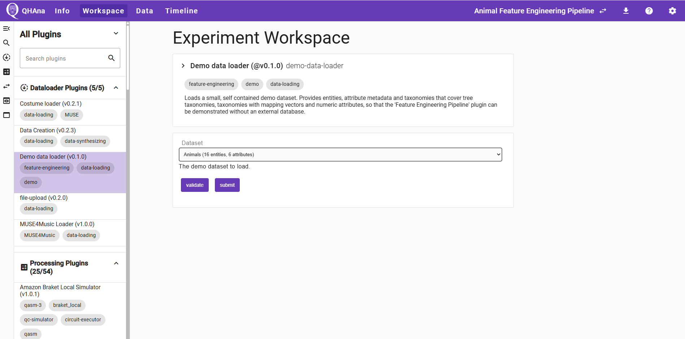

After submitting, verify the successful execution in the "Timeline" tab. The
plugin produces three files: the entity list, the attribute metadata, and a ZIP
file containing the taxonomies.

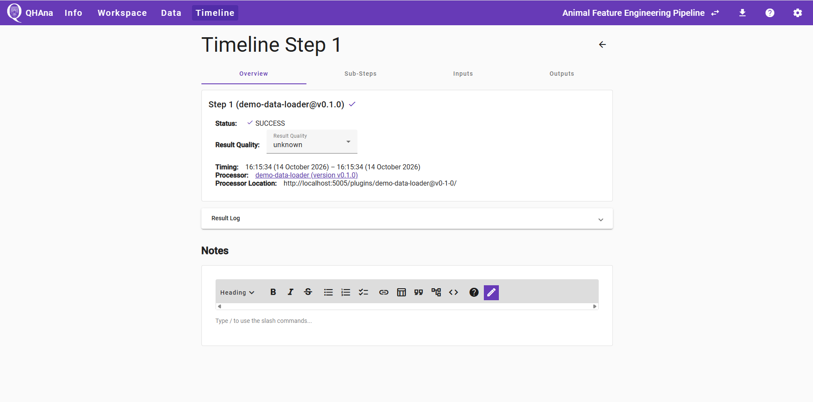

## The Feature Engineering Pipeline: Basic settings

Navigate to the "Workspace" tab and search and select the "Feature Engineering Pipeline"
plugin. Its first page is split into several sections:

- **Basic Data**: the "Entities URL", "Entities Attribute Metadata URL" and
  "Taxonomies URL" input fields. Use the "choose file" dialog to select the three
  outputs of the "Demo data loader" step here.
- **Transformer Settings**, **Wu-Palmer Settings**, **Mapping Settings** and
  **MDS Settings**: default settings for the sub-plugins used by the pipelines.
- **Vector Concatenation Settings** and **PCA Settings**: settings for combining
  and reducing the per-attribute vectors into one final feature vector.

> The settings on this page are **shared defaults for every attribute**. On the
next page, each attribute can override the Wu-Palmer, Mapping or MDS settings
individually. For this tutorial, we leave all of these shared defaults as they
are and only change the settings described below.

For this tutorial you have to change no other settings.
Feel free to test some other settings here.

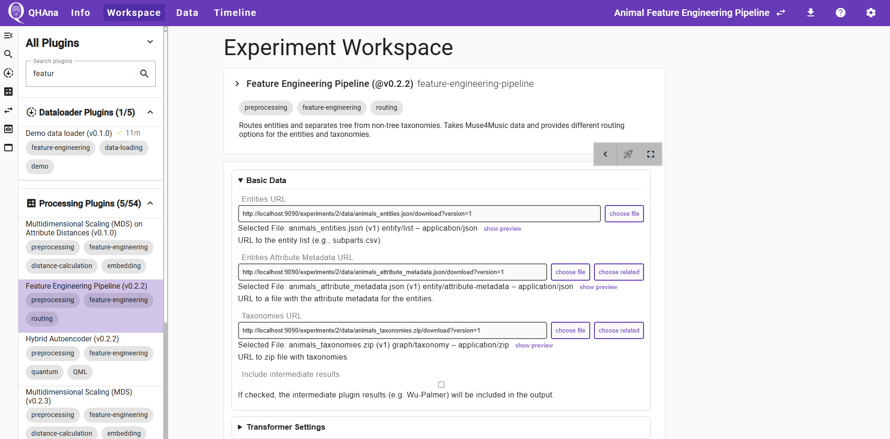

Click on submit to get to the attribute selection page, where you can assign the attributes to the pipelines.

## Assigning attributes to a pipeline

The second page lists every taxonomy attribute with a dropdown of pipeline
options ("None", "Wu-Palmer", "One-Hot", "Mapping"). The dropdown already marks
one option as "(Recommended)" for each attribute, based on whether its taxonomy
carries mapping values or not. Here, you can simply keep the
recommended option. Numeric attributes are listed separately with an "Include"
checkbox instead of a dropdown.

For the demo dataset, use the following selections.
This guide does not go into the per-attribute Wu-Palmer, Mapping or MDS settings
panels - for the demo dataset, the shared defaults from the previous page work
well.

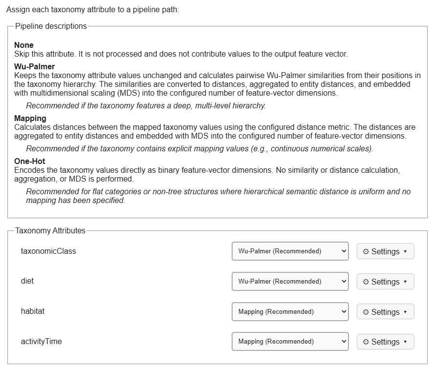

For the numeric values, the per-attribute setting for the normalization has to be activated (image only the first attribute):

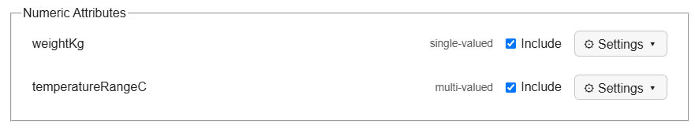
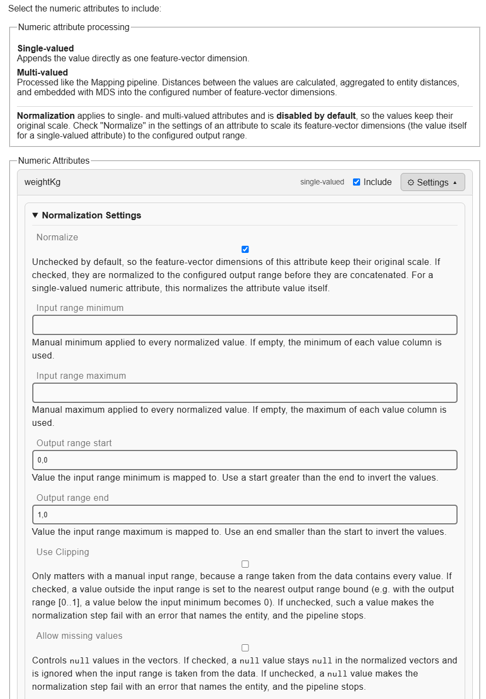

Finally, you can activate Principal Component Analysis (PCA) to reduce the dimensions to only three visualizable values.

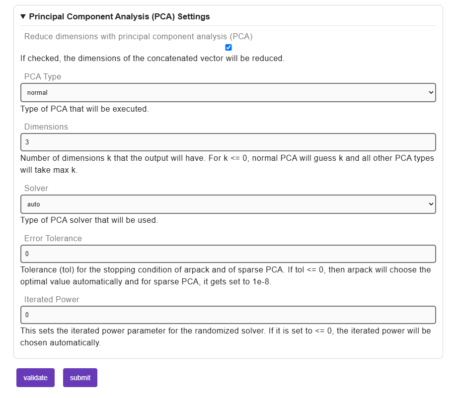

Once all attributes are assigned, click "submit" to start the pipeline execution.
Depending on the number of sub-plugins involved, this may take a moment; you can
follow the progress in the result log.
There, you can see the different pipelines that get executed and each executed sub-plugin is listed.

Once it is finished, the result log, states 'All Pipelines Completed Successfully And Dimensions Reduced With PCA!'.

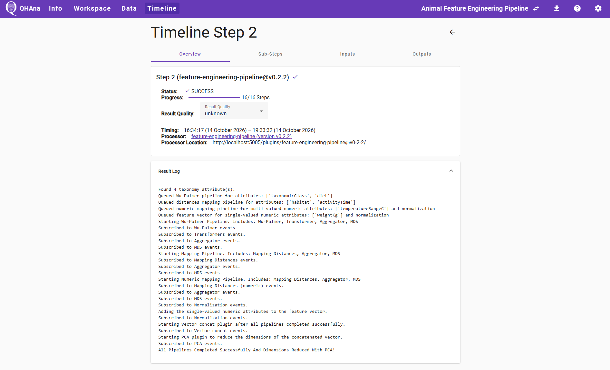

## Visualizing the results without clustering

As in the MUSE workflow, we can inspect the pipeline output before doing any
clustering. Switch to the "Outputs" tab of the timeline step and find the final,
concatenated and PCA-reduced entity vector file and a visualization preview.
Since no clustering is done,
this shows a plain 3D scatter plot of the animals - already a good opportunity to
check whether the reduced vector still separates the expected animal groups.

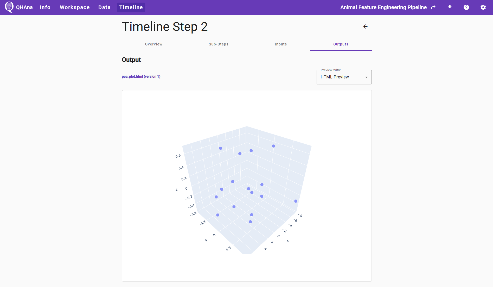

You can also find the final concatenated vector without the PCA reduction.
Here, you can also find a mapping file, that shows which dimension of the feature vector belongs to which attribute.
To visualize the original vector, select "Clustered Scatter Plot Visualization" right next to the ``final_concatenated_vector.csv``.  
This visualization shows which dimensions could be displayed at the three available axes.

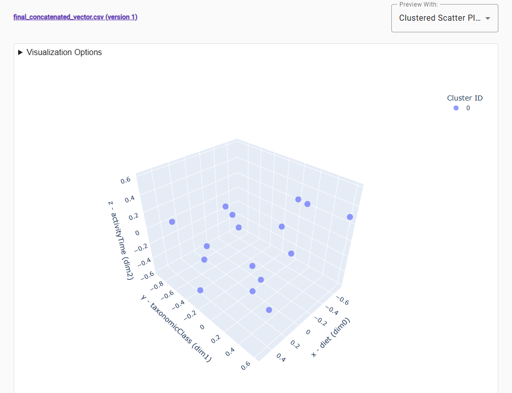

## Clustering the results

Now use a clustering plugin to group the animals. Select the "Classical k-Means"
plugin in the "Workspace" tab, choose the final entity vector file as input, and
set "Number of Clusters" to a value that matches the expected number of animal
groups in the dataset (e.g. **4**, for farm/grazing animals, land predators,
birds and marine animals - adjust if the resulting clusters do not look
meaningful). Tick the "Visualize" box to also generate an HTML plot.

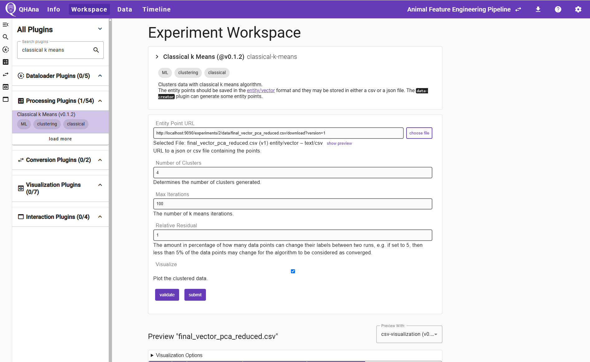

After submitting, switch to the "Outputs" tab. As in the MUSE workflow, you will
find a JSON file with the cluster labels and, because "Visualize" was ticked, an
HTML file with the plot.
The resulting cluster can differ.

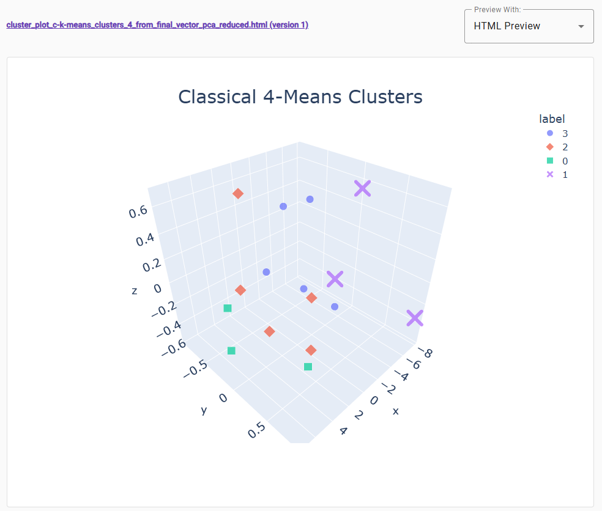

In the example cluster, you can see, that the cluster mainly chooses the x-axis for creating groups.
This is not a distinction into the suspected groups farm/grazing animals, land predators,
birds and marine animals.

### Processing the data a second time

As in the MUSE workflow, we can process the same entity vectors again with a
different settings or a different clustering plugin to compare results.

For example, you can select the "Classical k-Medoids"
plugin, choose the same final entity vector file as input, and set "Number of
Clusters" to a different value (e.g. **3**, for a coarser grouping). Tick
"Visualize" again and submit.
